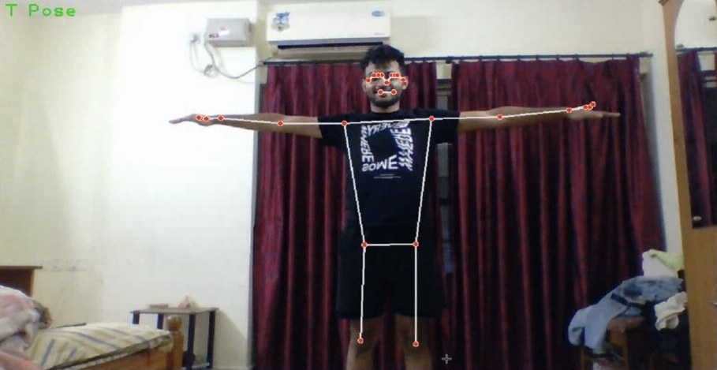
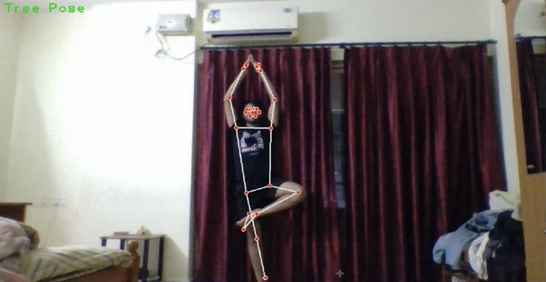
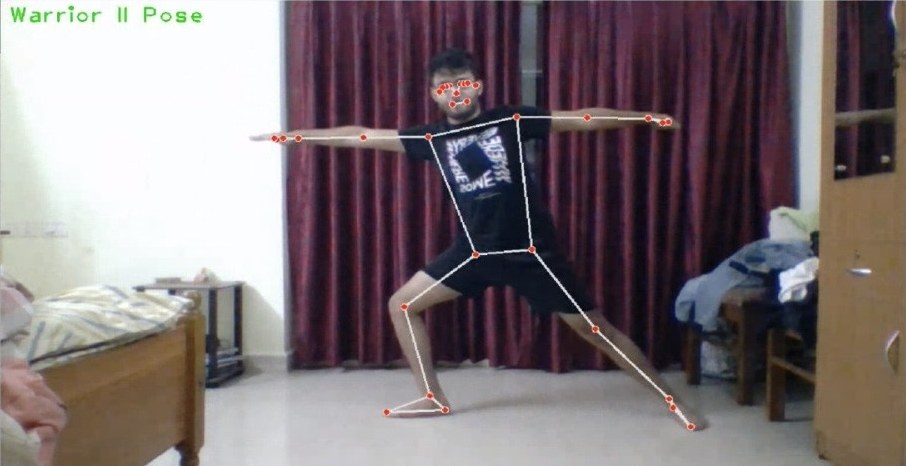
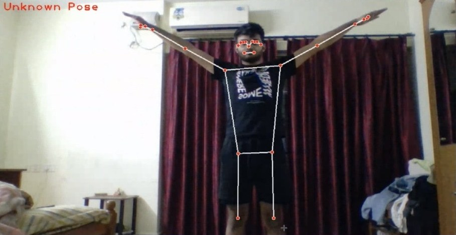

# Real-Time Pose Detection & Classification

[](https://github.com/SAMARTHJAISWAL/RealTimePoseDetection/actions/workflows/tests.yml)


Tracks **33 body landmarks** from a webcam, video, or image with Google's
[MediaPipe Pose Landmarker](https://ai.google.dev/edge/mediapipe/solutions/vision/pose_landmarker),
measures joint angles, and classifies yoga and fitness poses in real time:
**Warrior II**, **T Pose**, and **Tree Pose**.

| T Pose | Tree Pose | Warrior II | Unknown |
|:--:|:--:|:--:|:--:|
|  |  |  |  |

---

## Features

- **Real-time tracking** from any webcam, about 60 FPS on a laptop CPU with the default model.
- **Three pose classes**: Warrior II, T Pose, and Tree Pose. Anything else is reported as *Unknown*.
- **Mirror-invariant rules**: a pose is recognised whichever leg or arm leads.
- **Steady labels**: a majority vote over recent frames stops the label from flickering.
- **Confidence-aware**: if a limb is out of frame or occluded, the app says *Unknown* rather than guessing.
- **Joint-angle overlay**: press `a` to see the elbow, shoulder, and knee angles live.
- **Works on images and videos too**, and can save the annotated output.
- **Three model sizes**: `lite` (fastest), `full` (default), `heavy` (most accurate). Each downloads once on first use.
- **Unit-tested** geometry and classification logic that runs without a camera or MediaPipe.

## Quick start

Requires Python 3.9 or newer and a webcam.

```bash
git clone https://github.com/SAMARTHJAISWAL/RealTimePoseDetection.git
cd RealTimePoseDetection
python -m venv .venv && source .venv/bin/activate   # Windows: .venv\Scripts\activate
pip install -r requirements.txt
python main.py
```

On first run, the pose model (about 9 MB) is downloaded to `~/.cache/posedetect/`.

> **macOS:** run this from the **Terminal** app (or iTerm) and click **Allow**
> when it asks for camera access. Terminals built into editors and other apps
> often have no camera permission, so the camera fails to open. See
> [Troubleshooting](#troubleshooting).

Step back until your whole body, feet included, is in the frame, then try a pose.

| Key | Action |
|---|---|
| `a` | Toggle joint-angle overlay |
| `q` / `Esc` | Quit |

### No webcam? Try a sample image

```bash
python main.py --image assets/warrior_ii.jpg --show-angles
```

This prints `Pose: Warrior II Pose` and opens the annotated image. Press any
key to close it.

## Usage

```bash
python main.py                                  # webcam 0
python main.py --camera 1 --show-angles         # another camera, angles on
python main.py --model lite                     # faster on low-end machines
python main.py --model heavy                    # more accurate, slower
python main.py --image photo.jpg --output annotated.jpg
python main.py --video workout.mp4 --output annotated.mp4 --no-display
```

You can also install the project as a package (`pip install -e .`) and run it as
`posedetect` or `python -m posedetect`.

| Option | Default | Description |
|---|---|---|
| `--camera N` | `0` | Webcam index |
| `--video PATH` | | Classify a video file |
| `--image PATH` | | Classify a single image |
| `--model {lite,full,heavy}` | `full` | Speed/accuracy trade-off |
| `--model-path PATH` | | Use a local `.task` model file (offline use) |
| `--min-confidence X` | `0.5` | Detection and tracking confidence threshold |
| `--show-angles` | off | Draw joint angles at start-up |
| `--no-mirror` | off | Don't mirror the webcam image |
| `--smoothing N` | `8` | Frames to vote over for the label; `1` disables smoothing |
| `--output PATH` | | Save the annotated image or video |
| `--no-display` | off | Run without opening a window |

Set `POSEDETECT_MODEL_DIR` to change where models are cached.

## How it works

```
frame ─► MediaPipe Pose Landmarker ─► 33 landmarks (x, y, z, visibility)
      ─► visibility check ─► 6 joint angles ─► rule-based classifier
      ─► majority-vote smoothing ─► overlay (skeleton, label, angles, FPS)
```

1. **Landmarks.** MediaPipe returns 33 body keypoints per frame. Video and
   webcam input use its tracking mode, which is faster and steadier than
   detecting each frame from scratch.
2. **Joint angles.** The interior angle at each joint is computed from three
   landmarks:

   | Angle | Points |
   |---|---|
   | Elbow | shoulder – **elbow** – wrist |
   | Shoulder | elbow – **shoulder** – hip |
   | Knee | hip – **knee** – ankle |

   180° is a fully straight limb. Interior angles (0–180°) are the same for a
   pose and its mirror image, so left- and right-leading poses both match.
3. **Rules.** Each pose is a small, readable function in
   [`posedetect/classifier.py`](posedetect/classifier.py):

   | Pose | Arms | Legs |
   |---|---|---|
   | **Warrior II** | both elbows ≥ 165°, both shoulders 75–115° | one knee ≥ 165°, the other 90–120° |
   | **T Pose** | both elbows ≥ 165°, both shoulders 75–115° | both knees ≥ 160° |
   | **Tree Pose** | any | one knee ≥ 165°, the other 25–45° |

4. **Smoothing.** The label shown is the most common one over the last 8
   frames, so a single noisy frame doesn't flip it.

## Adding a new pose

1. Add the name to the `Pose` enum in `posedetect/classifier.py`.
2. Write a rule function that takes `JointAngles` and returns `bool`.
3. Add it to `RULES`. Rules are checked in order, so put more specific poses first.
4. Add a test in `tests/test_classifier.py`.

Run with `--show-angles` while holding the pose to see which angle ranges to use.

## Project structure

```
RealTimePoseDetection/
├── main.py                 # entry point: python main.py
├── posedetect/
│   ├── __main__.py         # CLI: webcam / video / image modes
│   ├── detector.py         # MediaPipe Pose Landmarker wrapper + model download
│   ├── classifier.py       # joint angles → pose rules
│   ├── angles.py           # angle geometry (pure math)
│   ├── landmarks.py        # the 33 landmark indices and skeleton edges
│   ├── smoothing.py        # majority-vote label smoothing
│   └── drawing.py          # OpenCV overlays
├── tests/                  # pytest suite (no camera needed)
├── assets/                 # sample screenshots, also used by the tests
├── requirements.txt
└── pyproject.toml
```

## Running the tests

```bash
pip install -e ".[dev]"
pytest                    # everything
pytest -m "not model"     # unit tests only: fast, works offline
ruff check .              # lint
```

- **Unit tests** cover the angle maths, every pose rule (including mirrored
  poses and near-misses), the visibility check, and label smoothing.
- **End-to-end tests** (`tests/test_end_to_end.py`) run the real MediaPipe
  model on the sample images in `assets/` and through the CLI. They catch
  breaking MediaPipe releases, and CI runs them every week for that reason.
  They download the model on first run.

No camera is needed for either.

## Troubleshooting

- **"not authorized to capture video" / "could not open camera 0" (macOS)**:
  the app you ran it from doesn't have camera permission.
  1. Run it from the **Terminal** app or iTerm instead of a terminal built into
     an editor or another app.
  2. Click **Allow** when macOS asks for camera access.
  3. If no prompt appears, open *System Settings → Privacy & Security → Camera*,
     turn on your terminal app, then quit and reopen it.
- **"could not open camera 0" (any OS)**: another app such as Zoom, Meet, or
  FaceTime may be using the camera, so close it. With several cameras, try
  `--camera 1`. On Linux, check that your user can read `/dev/video0`
  (usually by joining the `video` group).
- **Always "Unknown Pose"**: make sure your feet are in the frame, because the
  classifier needs the ankles. Press `a` to check the angles against the
  table above.
- **Low FPS**: use `--model lite`.
- **`AttributeError: module 'mediapipe' has no attribute 'solutions'`**: you
  are running the old v1 script. Recent MediaPipe releases removed the legacy
  `solutions` API, so pull the latest version of this repo, which uses the
  Tasks API.

## Tech stack

- [MediaPipe Tasks: Pose Landmarker](https://ai.google.dev/edge/mediapipe/solutions/vision/pose_landmarker) for body landmark detection
- [OpenCV](https://opencv.org/) for video capture and drawing
- [NumPy](https://numpy.org/)
- [pytest](https://pytest.org/) for tests

## Contributing

Issues and pull requests are welcome, and new poses are especially welcome.
Please add a test for any new rule and run `pytest` before opening a PR.

## Acknowledgments

- The Google MediaPipe team for the BlazePose model and Pose Landmarker.
- The OpenCV community.
